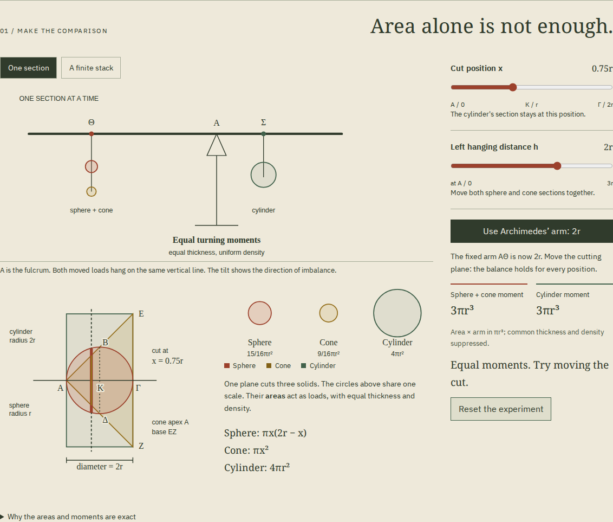
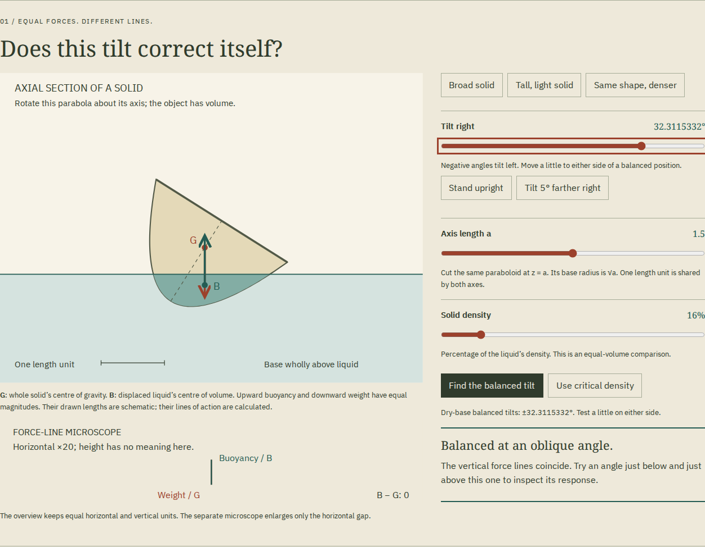
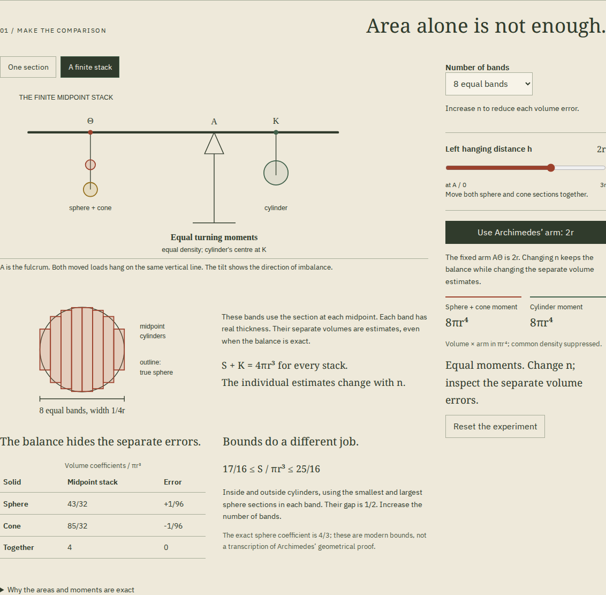
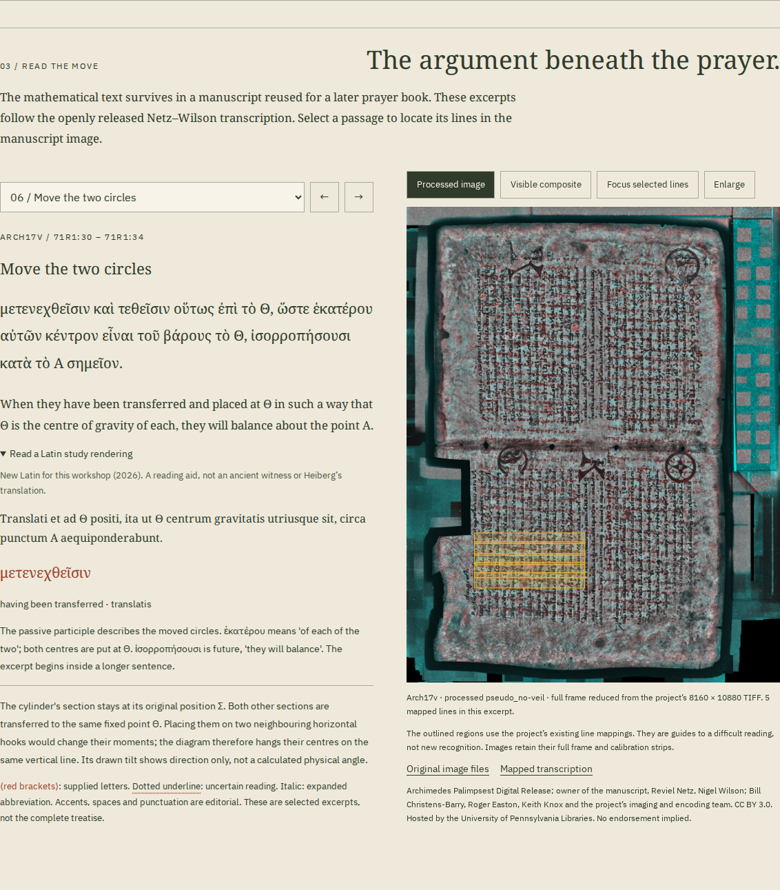

# Zygon

**Operate Archimedes' balance and floating bodies. Then read the conditions in Greek.**

[Workshop](https://antonsoo.github.io/zygon/) · [Code: MIT](LICENSE) ·
[Text, images and source licenses](public/sources/NOTICES.txt) · [Model](docs/model.md)

[Public source, hosted build and browser evidence](docs/publication.md)

A circle from a sphere and a circle from a cone can balance a much larger
circle from a cylinder. Their areas do not have to be equal: their turning
moments do. This workshop makes the transfer in Archimedes' _Method_ II
operable, then follows the argument into its surviving manuscript evidence.



## It floats. Will it stay upright?

The new [floating-body room](https://antonsoo.github.io/zygon/float.html#fl-bench)
starts with a solid that is balanced upright but unstable. Give it a small tilt:
equal weight and buoyancy act through different vertical lines, turning it
farther over. Find its separate **32.3115332°** dry-base equilibrium, then test
both sides. Keep the shape and increase its density; upright becomes stable.


- Change shape, density and tilt with native keyboard controls. A separate
  microscope enlarges small force-line gaps without distorting the body.
- Inspect the critical density: zero linear stiffness still allows a finite
  restoring turn. Balanced, stable and critical remain different claims.
- Tilt beyond base contact. The workshop withholds displaced volume and force
  results, rather than extending the dry-base cap formula through the solid's cut.
- Read six Greek/English passages, five corresponding Latin excerpts and sixteen
  contextual word notes. Inspect three complete processed manuscript frames and
  four full printed pages, with mapped line focus and keyboard panning.
- Compare two real transmission problems: the 1881 Latin proof stops early, and
  its taller-solid condition omits a denominator supplied in a footnote. The
  missing Latin continuation is not invented; supplied Greek letters stay marked.
- Save editable JSON, a turning CSV, a font-embedded SVG or one script-free
  illustrated reading with all source images, original transcriptions, fonts and
  licenses. Both rooms work after the complete offline edition is saved.

This is a modern static model of a uniform solid paraboloid in flat, still,
unbounded liquid. It does not simulate a timed return, hollow boat, waves,
material manufacture or a measured physical object. The source's geometrical
arguments remain distinct from our coordinates and numerical cross-checks.

[Source and derivation](docs/float-model.md) ·
[Actual workflow and review](docs/float-review.md) ·
[Retained illustrated reading, gzip](examples/floating-reading.html.gz) ·
[Actual browser PDF](examples/floating-reading.pdf) ·
[Editable experiment](examples/floating-experiment.json) ·
[Turning CSV](examples/floating-turning.csv) · [Drawn SVG](examples/floating-drawing.svg).
Decompress the retained HTML before opening it.

```sh
npm run verify:float
npm run verify:float-sources -- --online
npm run test:float -- http://127.0.0.1:4350/zygon/ /tmp/zygon-floating
npm run verify:float-print -- /tmp/zygon-floating/chromium-1440/reading.pdf /tmp/zygon-floating/print.json
```

Build and serve the production edition with `npm run build` and `npm run preview`
before the browser review. It uses the existing Playwright Chromium and Firefox
installations. Source-image reproduction requires the identified original TIFFs,
1881 PDF, Pillow and Poppler; normal learner use downloads none of those TIFFs.

## Find one arm for every cut

Start with the cutting plane half a radius from the fulcrum. The sphere's
section has area 3πr²/4, the cone's πr²/4, and the cylinder's 4πr². Put the
pair one radius to the left: its moment is only half the cylinder's.

Move the pair to **2r**. The circles retain their areas, but their moments
now agree. Move the cutting plane; the same left arm continues to work.
The zero cut is explicitly inconclusive because both moments vanish there.
Native range controls support mouse, touch and keyboard. Shared URLs retain
the experiment and selected reading, and browser Back restores them.

The source uses a large auxiliary cylinder with radius **2r**, not the smaller
cylinder that just encloses the sphere. A dimensional table keeps the two
cylinders and two cones distinct. Subtracting the cone's known volume from
the balance comparison gives the sphere's volume; the cone theorem remains
an explicit input.

## A perfectly balanced approximation can still be wrong

Switch to a finite stack. With eight midpoint bands the sphere estimate is
**43πr³/32**, while the cone estimate is **85πr³/32**. Their errors are
**+πr³/96** and **−πr³/96**. The moments cancel exactly despite those errors.



Increase the number of bands and inspect the separate errors and exact
inside/outside cylinder bounds. These bands are a modern illustration;
Archimedes' distinction between mechanical discovery and geometrical
demonstration stays visible. Section comparisons suppress common thickness
and use πr³ coefficients. Whole-solid moments use πr⁴.

## Inspect the argument beneath the prayer

Ten Greek excerpts include new English translations, contextual grammar and
new Latin study renderings. The Latin is explicitly a **2026 reading aid**,
not an ancient witness or Heiberg translation.



The reader retains supplied letters, uncertain readings and expanded
abbreviations. Its line outlines reuse the Archimedes Palimpsest project's
published coordinates. Compare the supplied visible composite and processed
image, focus the selected lines, switch between fragments of a split excerpt,
or enlarge the image and scroll with the keyboard.

One passage in the released transcription says **διπλασία**, 'twice', of the
small cone; the later conclusion says **τετραπλασίων**, 'four times'. Both
readings remain visible. The geometry and later conclusion give four, but
the app does not invent a new decipherment or identify the origin of the
discrepancy.

The six full-frame images are reduced from the project's registered TIFFs,
checked against its published original-file checksums. Original creator
descriptions, complete transcriptions, licensing and reduction provenance are
included. No mathematical letter has been retouched.

## Keep a study

Save the balance as SVG, all 201 section positions as an exact-fraction CSV,
or the experiment and complete reading as one **script-free HTML file**.
The illustrated study embeds its six images once, reuses them for the mapped
excerpts, and retains all ten readings, language notes, fonts, licenses and
downloadable source files. Open it from disk or print it to PDF. The production
site also saves the complete edition for disconnected use; it reports readiness
only after checking the active edition and cache inventory.

[Saved study](examples/zygon-study.html) · [PDF](examples/zygon-study.pdf) ·
[Balance SVG](examples/zygon-balance.svg) · [Section CSV](examples/zygon-sections.csv)

## Run locally

Node 24 or newer:

```sh
git clone https://github.com/antonsoo/zygon.git && cd zygon
npm ci
npm run dev
```

Open `http://127.0.0.1:4350/zygon/`. To review a production edition, stop the
development server, run `npm run build`, then `npm run preview`. The build
output is `dist/`, with the `/zygon/` base path used by GitHub Pages.

## How it works and what is limited

The pure [model](src/model.ts) uses reduced BigInt fractions. Its section
identity is `x(2r-x) + x² = 2rx`; the fixed 2r arm turns that identity into
the lever comparison. Finite midpoint sums and enclosing-cylinder bounds
are computed directly. The [model and source decisions](docs/model.md)
derive the formulas and explain the two cylinders, text selections,
editorial uncertainty and image processing.

The beam has no mass, density is uniform, thickness is common, and deflection
shows only imbalance direction. The model does not reconstruct a surviving
instrument. Finite bands are not literal indivisible circles or a reproduction
of Archimedes' geometrical proof. Translations and grammar are teaching aids
without independent philological peer review. A browser print is not a tagged
or professionally typeset edition.

The Greek derives from the [Archimedes Palimpsest Digital Release](https://archimedespalimpsest.net/),
primary transcriptions by Reviel Netz and Nigel Wilson. Image creators include
Bill Christens-Barry, Roger Easton and Keith Knox; full credits remain in the
source headers and metadata. For a public-domain mathematical cross-check,
see T. L. Heath, [_The Method of Archimedes_ (1912)](https://www.wilbourhall.org/pdfs/archimedes/archimedesHeiberg.pdf),
proposition 2, pp. 18–21.

## Review

```sh
npm run check
npm run verify:model
npm run verify:sources
```

The independent Python `Fraction` oracle checks **62,909** cut/arm and
stack/arm cases with **389,494** exact comparisons. The source review
regenerates all ten excerpts and verifies their supplied/unclear/expanded
flags, 52 mapped lines and retained asset identities. `--online` additionally
checks the small original transcription files and TIFF checksum sidecars.
Reproducing image reductions requires the six original TIFFs, Pillow and
`python3 scripts/prepare-images.py ORIGINALS_DIR`; normal use downloads none
of those large TIFFs.

With the production preview running and matching Playwright browsers installed:

```sh
node scripts/browser-review.mjs http://127.0.0.1:4350/zygon/ /tmp/zygon-review
npm run verify:print -- /tmp/zygon-review/chromium-1440/study.pdf /tmp/zygon-print.json
```

The browser review operates Chromium and Firefox at desktop and phone widths,
opens actual downloads from disk, checks image hashes and exercises a
disconnected installed edition. The print review uses Poppler to inspect the
actual PDF. [Recorded review](docs/review.md) separates local, public-source
and hosted evidence.

## Contributing and license

See [CONTRIBUTING.md](CONTRIBUTING.md). Code and new mathematical diagrams are
MIT. Source images, adapted Greek and new teaching text use CC BY 3.0; font
licenses and full attribution are in [the notices](public/sources/NOTICES.txt).
